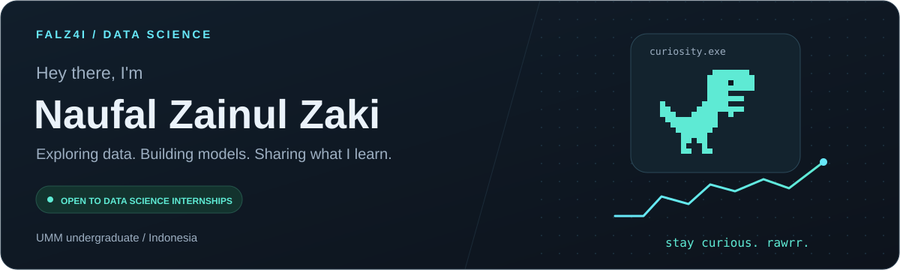
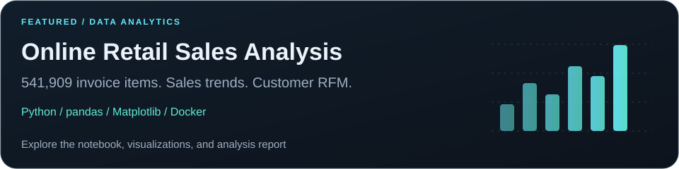
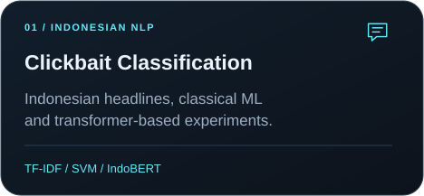
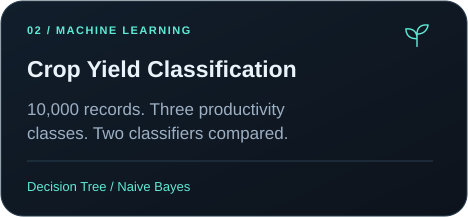
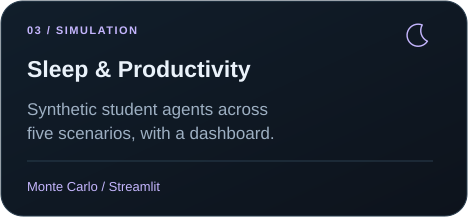
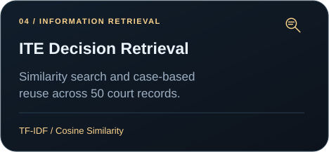

  <picture><source media="(max-width: 600px)" srcset="./assets/banner-mobile.svg" /></picture>

  
  &nbsp;
  

### A little about me

I'm **Naufal**, an Informatics Engineering undergraduate at **Universitas Muhammadiyah Malang**, pursuing the **Data Science** track.

- **What I explore:** data analysis, machine learning, and Indonesian natural language processing.
- **What I'm practicing:** preparing data, evaluating models, and explaining results through notebooks and visualizations.
- **What's next:** a **Data Science internship** where I can keep learning and contribute to real projects.

### My toolbox

  

**Data & visualization:** pandas · NumPy · Matplotlib · JupyterLab 
**Models & apps:** scikit-learn · Hugging Face Transformers · Mesa · Streamlit

### Featured work

A selection of academic and learning projects. **Click a card to explore the repository.**

<a href="https://github.com/Falz4i/online-retail-sales-analysis"><picture><source media="(max-width: 600px)" srcset="./assets/retail-mobile.svg" /></picture></a>

  
  

  
  

<b>Project context</b>

The repositories contain the available code, data sources, evaluation notes, and limitations. Group projects credit their co-authors. The sleep simulation uses synthetic data; its outputs describe model behavior under stated assumptions.

### GitHub activity

  
  

  

Language percentages describe repository contents, including notebooks. Statistics may take time to refresh.

### Let's connect

Interested in data projects, learning together, or internship opportunities? 
**[naufalzainulzakiumm@gmail.com](mailto:naufalzainulzakiumm@gmail.com)**

Curious about data. Always learning. A little rawrr. 🦖

Visual credits

Custom banner and project cards for this profile. Technology icons by [Skill Icons](https://github.com/tandpfun/skill-icons), statistics by [GitHub Stats Extended](https://github.com/stats-organization/github-stats-extended), and contribution streak by [GitHub Readme Streak Stats](https://github.com/DenverCoder1/github-readme-streak-stats).

